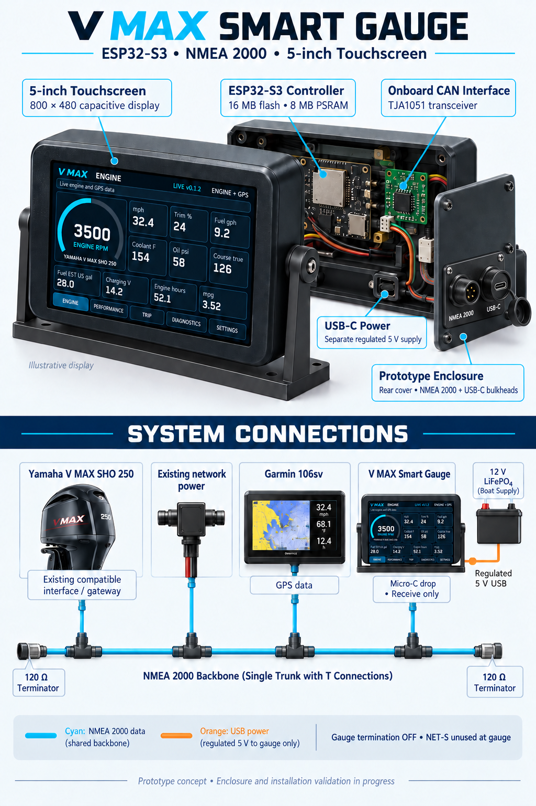

# V MAX Smart Gauge

ESP32-S3 based NMEA 2000 multifunction display inspired by the Yamaha 6YC gauge.

[In-dash mount design v1](enclosure/in-dash-v1/README.md) includes the current
170 x 130 mm bezel, both rear-cover options, CAD/STLs and dimensioned drawings.

## First live firmware

[Live Gauge v0.1.2](docs/Live-Firmware-v0.1.md) combines confirmed engine/GPS decoding,
the five-page touch display, versioned five-second boot screen, session trips,
CAN diagnostics, saved tank capacity and starting fuel amount and optional raw USB capture. The default PlatformIO target is
`live-gauge`; scanner and simulator builds remain available. This is a first
boat-test build; existing CAN errors and hardware validation remain outstanding.

## Target Boat Setup

- 2024 Yamaha V MAX SHO 250
- Garmin 106sv
- Existing powered NMEA 2000 backbone
- Spare NMEA 2000 drop connection available

## Planned Hardware

See the [bill of materials](hardware/BOM.md) for selected parts, procurement
status, and saved specifications for enclosure design.

- Waveshare ESP32-S3-Touch-LCD-5
- 5 inch 800x480 capacitive touchscreen
- ESP32-S3-WROOM-1-N16R8
- Onboard TJA1051 CAN transceiver
- microSD logging
- LiFePO4 battery USB power
- NMEA 2000 Micro-C drop connection

## Planned Features

- Engine RPM
- Trim
- Engine temperature
- Alternator voltage
- Fuel flow
- Engine hours
- Engine alarms/status
- GPS speed and course
- Fuel level
- Calculated MPG / fuel economy
- Trip computer
- Performance logging
- Cruise optimizer
- NMEA diagnostics
- OTA firmware updates
- Water-resistant marine enclosure

## Initial NMEA 2000 PGNs

- 127488 - Engine Parameters, Rapid Update
- 127489 - Engine Parameters, Dynamic
- 127505 - Fluid Level
- 129025 - Position, Rapid Update
- 129026 - COG & SOG, Rapid Update
- 129029 - GNSS Position Data

## Project Phases

1. Build a receive-first NMEA 2000 scanner.
2. Capture and identify the Yamaha and Garmin data actually present on the boat.
3. Build a diagnostics screen.
4. Build the Yamaha-style main engine display.
5. Add performance, trip, and logging screens.
6. Add OTA firmware updates.
7. Design and test the water-resistant enclosure.

## Wiring and Installation

See the [Complete Boat Wiring Guide](docs/Complete-Wiring.md) for Yamaha engine interface paths, Garmin GPS connection, NMEA 2000 topology, manufacturer part numbers, gauge pin mapping, power wiring, and dockside/boat-test checks. Engine-interface selection depends on the installed Yamaha harness; the guide identifies what must be verified before purchase.

## Repository Layout

- `docs/` - design and engineering documentation
- `firmware/` - ESP32 firmware
- `hardware/` - wiring, schematics, and component notes
- `nmea/` - captures and PGN notes
- `ui/` - UI mockups and assets
- `enclosure/` - CAD and enclosure design

## Status

Live Gauge v0.1.2 is implemented and has been uploaded to the ESP32-S3. It includes
five touch-display pages, live engine/GPS decoding, session trips, CAN diagnostics,
and saved fuel configuration with fuel inventory tracking. Scanner and simulator
builds remain available.

Builds, portable host tests, and replay of the saved boat capture have passed, as
documented in the [live firmware guide](docs/Live-Firmware-v0.1.md). Existing CAN
errors remain unresolved; on-device screen/touch checks, saved-setting recovery,
and live engine/GPS comparison on the boat are still pending. This is an initial
boat-test build, with hardware validation outstanding.

Next work includes resolving CAN errors and completing hardware/boat acceptance
checks. Persistent trips, microSD logging, Wi-Fi/OTA updates, and further enclosure
design and testing remain future work.
