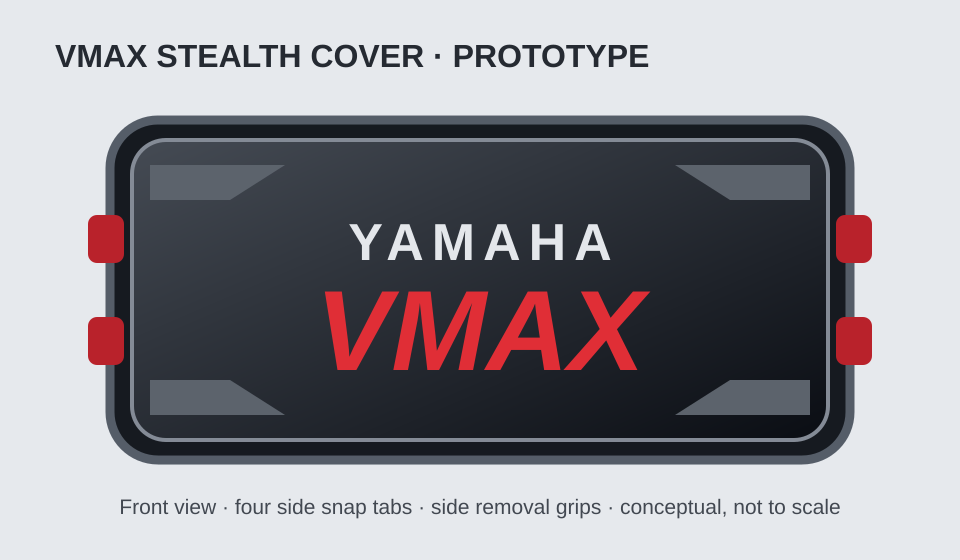

# VMAX Smart Gauge — Removable Protective Cover Design

**Status:** Concept approved; mechanical prototype pending measurements.  
**Target:** Waveshare ESP32-S3-Touch-LCD-5, 800×480, in-dash marine installation.  
**Printer:** Ender 3; initial material PETG.  
**Companion assembly:** Future custom in-dash enclosure, designed concurrently.

## Approved visual direction

The approved session concept is an aggressive, raised, low-profile marine accessory: matte-black angular beveled face, bold YAMAHA VMAX branding, accent colors, recessed center, and integrated grip lips. The SVG above is a repository-native **schematic redraw**, not the original photorealistic concept rendering; the original PNG is retained in the design-package ZIP produced during the design session.

## Requirements and decisions

1. Removable cover protects the display when not in use; **not** intended as a watertight operating enclosure.
2. Cover clicks into matching catches on the gauge mounting bezel, **not** the dashboard.
3. Four flexible snap tabs total: **two on each side**; accessible left/right removal lips allow tool-free release.
4. The gauge mounting enclosure is not finalized; cover and bezel must be modeled as a **matched assembly**.
5. **Two-piece glued cover** to reduce support material and improve visible-surface quality:
   - **A — decorative front shell:** black face, angular bevels, raised/recessed branding and color details, printed show-face up.
   - **B — rear structural snap frame:** integral clips, rear recess, locating features and bonding flange; print in orientation that favors clip strength.
6. **Two-color print** desired. Initial recommendation black + red; silver YAMAHA treatment from concept requires separate finishing or a different color strategy. Do not describe black/red/silver as a two-filament print.
7. Small side finger lips should be textured, rounded, and not obstruct the touchscreen or adjacent dash hardware.
8. Maintain the visual language of Yamaha VMAX SHO without claiming OEM affiliation.

## Preliminary engineering targets (adjustable, not final dimensions)

| Feature | Starting target / constraint |
| --- | --- |
| Front shell nominal wall | 2–2.5 mm PETG |
| Perimeter bonding flange | 4–6 mm wide |
| Alignment | Four locating pins and matching sockets |
| Snap tabs | Four integral cantilever clips, rounded roots |
| Clip engagement | Match bezel catch geometry after measurement |
| Adhesive | PETG-compatible, tested on coupons |
| Adhesive control | Relief channels away from flexing clips |
| Display clearance | Maintain clearance from glass and bezel; verify in CAD |
| Exterior | Shallow raised profile, angular bevels, grip lips |
| Environment | UV, heat, splash and vibration exposure on a boat |

**No dimensional accuracy is implied by the concept artwork.** Before producing fit-critical STLs, measure the actual display module, exposed bezel, dash cutout, mounting depth, nearby obstructions, and gasket/seal interface.

## Manufacturing and assembly plan

1. Measure hardware and design parametric bezel + cover interfaces.
2. Print a **small snap/catch calibration coupon** first; test insertion/removal force and durability.
3. Print decorative shell face-up with planned color changes; verify that unsupported bevels do not require excessive supports.
4. Print rear frame separately; orient clip roots and layer lines to resist repeated bending; tune clearance on coupons.
5. Dry-fit locating pins, perimeter flange and clip operation.
6. Bond parts with verified PETG-compatible adhesive, keeping adhesive clear of tabs; cure fully before use.
7. Test removal using both grip lips; inspect stress whitening, cracks and bond-line separation.

## Prototype validation checklist

- [ ] Verify Waveshare board/display outline and screw/connector locations
- [ ] Verify dash opening, thickness, rear clearance and cable access
- [ ] Verify mount retains the display independently of the cover
- [ ] Verify bezel catches align with two clips per side
- [ ] Verify clips survive repeated cycles without cracking
- [ ] Verify grip lips work with wet fingers
- [ ] Verify adhesive joint does not interfere with clip flex
- [ ] Verify face clears glass and any touch-sensitive region
- [ ] Verify two-color print workflow on Ender 3
- [ ] Verify outdoor UV/heat behavior and splash-shedding geometry
- [ ] Photograph installed and removed prototypes; revise CAD

## CAD deliverables planned

- Parametric in-dash mounting bezel/enclosure
- Parametric decorative front shell
- Parametric rear snap frame
- Clip/catch fit-test coupon
- Assembly drawing and exploded view
- Separate STL/3MF exports and print/assembly instructions

## Risks / open decisions

- Snap fit and tolerances depend on final bezel geometry and actual printer calibration.
- PETG clips can fatigue, especially under heat and prolonged deflection; test before boat use.
- Glue selection and surface preparation require coupon testing.
- Two-color limitation conflicts with concept's black, red **and** silver palette; choose a final production treatment.
- In-dash sealing, drainage and display cooling belong to the enclosure design and remain unresolved.

## Design-session history

- Initial request: removable protective in-dash VMAX cover with YAMAHA VMAX wording, two-color printing, two side tabs per side and removal lips.
- Approved styling: aggressive raised factory-accessory appearance with angular bevels and dark VMAX colorway.
- Mount not yet finalized: design both enclosure and cover as matching parts.
- Revised manufacturing decision: split into two glued pieces to minimize supports.
- Engineering additions: locating pins, broad glue flange, adhesive relief, integral rear clips and test coupon.

**Scope:** design specification and visual prototype only; no printable, dimensionally validated CAD files yet.
