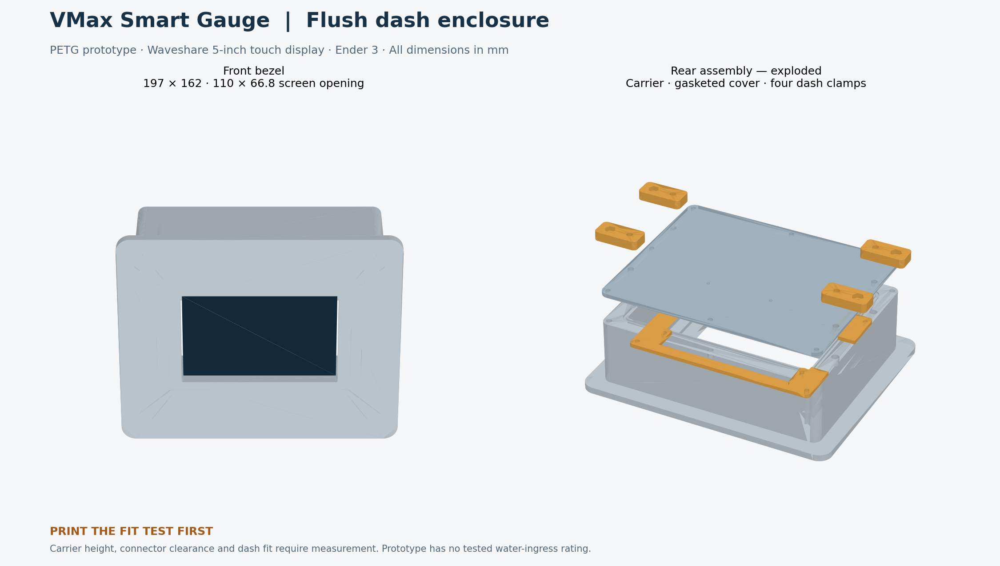

# VMax Smart Gauge — flush dash enclosure, prototype v1

Designed for Waveshare ESP32-S3-Touch-LCD-5 / SKU 28117, landscape orientation, Ender 3, PETG. Units are millimetres. This is a printable mechanical prototype, not a physically verified production enclosure. **Print `fit_test.stl` first. Do not cut the boat dash from the template until the actual board, connectors and assembled enclosure have been checked.**

## Files and quantity

| File | Quantity | Purpose |
| --- | ---: | --- |
| `STL/fit_test.stl` | 1 first | Glass-pocket clearance and visible-screen opening check |
| `STL/body.stl` | 1 | Integrated front bezel, glass seat, enclosure walls and carrier posts |
| `STL/carrier.stl` | 1 after measuring | Removable support attaching to the board's mounting points |
| `STL/cover.stl` | 1 | Rear service cover, sealed by continuous silicone cord |
| `STL/clamp.stl` | 4 | Rear brackets with M4 jack screws pressing against the back of the dash |
| `CAD/vmax_dash.scad` | — | Editable parametric source; OpenSCAD can export each part |
| `drawings/dash-template.svg` | — | Proposed cutout; print at 100% and check the 100 mm calibration line |
| `drawings/preview.png` | — | Overview rendered from the exported meshes |
| `drawings/mesh-checks.json` | — | Computational geometry checks; these do not prove physical fit or sealing |

## Current dimensions

Owner-supplied installation measurements: dash thickness **1/8–1/4 inch (3.175–6.35 mm)**; space behind the dash **4–5 inches (101.6–127 mm)**. The existing enclosure dimensions fit this depth range, so no STL geometry change was required. The stated depth does not establish horizontal/vertical clearance for the bezel or surrounding instruments.

With a provisional 1 mm compressed dash gasket, the rear cover sits approximately 45.7–48.8 mm behind the rear dash surface. This leaves about 52.8–81.4 mm before the reported rear obstruction, excluding projecting glands, brackets, screw heads and cable bends. Check their actual projection and the local space at each cable entry.

| Feature | Prototype value |
| --- | --- |
| Glass outline | 127.7 × 87.45, from the manufacturer touch-version drawing |
| Active display area | 108 × 64.8, from the drawing |
| Board mounting-point grid | 111 × 63, from the drawing; inspect thread/through-hole type |
| Front opening | 110 × 66.8, radius 1 corners |
| Glass pocket | 128.5 × 88.25, 0.4 clearance per side |
| Bezel overall | 197 × 162, radius 10 corners, 5 thick |
| Body outside | 173 × 138, radius 6 corners |
| Body cavity | 145 × 110 above the glass seat |
| Body behind bezel | 50 |
| Rear cover | 3 thick |
| Proposed dash cutout | 174 × 139, radius 6.5 corners |
| Housing depth behind bezel, including cover | 53; allow extra space for glands, connectors, cable bends and brackets |

The carrier contact plane is **provisional**, based on `glass_to_pcb_back = 11.5` and a 0.6 compressed front seal. Confirm the distance from front glass face to the board's rear mounting land with calipers. Match the carrier position to that land, not the tallest component. Adjust `glass_to_pcb_back` and regenerate the body before a full print. Carrier holes have ±1 mm Y slots; verify the 111 × 63 grid and glass-centre offset. Check that pads and carrier edges touch only mounting lands, not solder joints, antenna, components or ribbon cables. The carrier has reliefs for the right-side USB and lower terminal block; confirm orientation and clearance on your revision.

## Print order and settings

1. Print the fit test with the same filament and slicer compensation intended for the case. Its wide flat face is already at Z=0. Set the display gently into the pocket with a temporary seal sample. It should fit freely without forcing the glass. Power the screen on and confirm every corner of the active display remains visible.
2. Measure the glass-to-PCB mounting plane, check carrier hardware, dry-fit a USB cable and terminal wires, then edit the source as needed. A compact right-angle USB plug may be needed; the cavity allows only about 12 mm beyond each PCB side, so do not assume a straight plug fits. Enlarge `cavity_w` if needed, and regenerate the entire set/template.
3. Print the carrier and trial-fit it to the board before printing the body. Stop if anything bears against electronics. Check screw engagement and use spacers if the actual mounting points require them.
4. Print body, cover and four clamps. No support is intended in the supplied bed orientations. Inspect your slicer's preview before starting.

Suggested starting settings for a 0.4 mm nozzle: 0.20 mm layers, five perimeter walls, six top/bottom layers, 30% gyroid infill, approximately 35 mm/s outer walls, and a 5 mm brim on the body. Print clamps with six walls and 60–100% infill. Use your PETG manufacturer's temperature profile within your hotend's approved limits; the Ender 3's exact hotend configuration has not been established. Avoid printing G-code for an unspecified printer variant. Keep scale at 100%.

The largest part plus a 5 mm brim occupies approximately 207 × 172 mm. Check bed clips and usable travel in your slicer. Keep gasket lands free of strings, blobs and elephant-foot ridges. Lightly finish sealing surfaces without rounding them unevenly. PETG is the selected prototype material; inspect it for heat distortion and clamp creep after sun exposure. A light-coloured bezel is a reasonable first prototype choice for the exposed helm.

## Hardware and seals

| Item | Quantity / selection |
| --- | --- |
| M3 heat-set inserts | 12: eight rear-cover, four carrier-post; select OD/length first |
| M4 heat-set inserts | 4: rear clamp anchors |
| M3 machine screws + washers | 12; around 8–10 mm long, adjusted to actual inserts/washer stack |
| M2.5 display mounting screws | 4, length and thread type verified against the actual module; do not substitute screws that bottom out |
| M4 clamp-anchor screws + washers | 4; nominally 16 mm for 7 mm bracket + 3 mm cover + insert engagement; verify blind-hole depth |
| M4 nuts | 4 for jack-screw pockets; nominal 7 mm across flats, pocket 7.19 mm across flats |
| M4 jack screws + locknuts + padded feet | 4 fully threaded M4 × 60 mm as an initial selection for the supplied dash thickness; verify pad thickness and engagement on the assembled case |
| Silicone cord | 2 mm diameter; one continuous rear-cover loop, about 0.55 m plus allowance; seal its joint |
| Front glass seal | Thin closed-cell silicone foam on black glass border, plus compatible neutral-cure electronics-safe silicone perimeter seal |
| Dash seal | Continuous closed-cell silicone foam under the bezel around the cutout |
| Sealed cable glands | 2, sized to actual cable jacket diameter and rear-cover panel thickness |
| Hydrophobic membrane vent | 1, exact panel-hole size and installation from its supplier |

Use corrosion-resistant hardware and padded screw feet. Insert hole diameters default to 4.2 mm (M3) and 5.6 mm (M4), depth 6 mm. These are editable placeholders: insert dimensions vary. Test one hole with your insert before installing all of them. Install inserts with controlled heat and keep them below the mating surface. Do not split or bulge the printed wall. Cover screws and clamp anchors sit outside the rear gasket path.

Rear gasket groove: 2.4 mm wide × 1.4 deep. The intended starting point for 2 mm silicone cord is 30% compression when the cover meets the body land. Actual cord hardness, diameter, printer accuracy and supplier guidance determine the final groove. Do not substitute a 2 mm-wide flat strip without redesigning the groove. Front foam compression is independent of the rear cord.

The cover is intentionally unperforated except screw holes: three inside pilot dimples identify two gland locations and one vent location. Set `gland_d` and `vent_d` to actual supplier cutout diameters before exporting, or drill to the supplier specification. Gland outside threads/locknuts must clear the board, rear screws and wiring. A moulded USB plug may not pass through a gland: use an appropriate split gland or an assembly method suited to the cable. Verify sealing on the cable jacket; a large drilled hole filled with silicone is not an equivalent gland.

## Assembly and dash mounting

1. Dry-fit all parts, insert hardware and cables with power off. Fit a front border gasket so it seals against the glass's black border without overlapping the display or pressing the active LCD. Retain exposed touchscreen glass; no clear cover is included.
2. Fasten the module lightly to the removable carrier using its verified mounting hardware. Lower this assembly into the rear of the body and attach the carrier to the four posts. The front glass should seat evenly with the intended foam compression. Adjust the carrier plane/spacers if needed; never pull a warped or poorly fitting assembly into place with screw torque. Apply the compatible perimeter seal around the glass-to-bezel interface. Allow full cure. This front joint remains assembled when the rear cover is removed.
3. Route USB power and CAN wiring through the selected glands, with strain relief and service slack. Preserve access to internal USB, BOOT, RESET and SD when the cover is removed. Leave antenna clearance. Follow the project's wiring guide: USB 5 V supply, no NET-S power connection at the gauge, CAN termination OFF.
4. Fit the rear cord gasket and rear cover. Install eight M3 cover screws gradually in an alternating pattern until the cover meets the land. Do not over-tighten.
5. Check physical clearance on the boat. The supplied template assumes a NEW cutout; it does not establish compatibility with an existing gauge hole. Trial-fit the assembled enclosure into a mock dash panel of the same thickness before modifying the boat. Check the cutout dimensions and gasket overlap on the actual printed part.
6. Add the dash gasket behind the front flange, insert the enclosure from the front, and fit four clamps from behind. Each clamp's anchor hole is at X=0 and jack screw is 16 mm toward the outer side. Use one M4 anchor screw through bracket and cover into each rear M4 insert; mirror left brackets so their jack screws face outward. Capture an M4 nut in each outer pocket and run a jack screw toward the dash. Use a padded swivel foot or protective pad at each contact point.
7. Tighten the four jack screws only enough to compress the dash gasket and prevent movement; secure with locknuts. The brackets are at the rear of the enclosure, so jack screws bridge the depth back to the dash. Required screw reach is approximately `53 mm - compressed dash gasket thickness - dash thickness`, plus bracket/nut engagement and pad geometry. Measure the actual assembly before buying screws. Over-tightening can deform PETG or damage the dash. All hardware is accessible from behind; no separate fastener holes are needed through the dash.

For the supplied thickness range and an assumed 1 mm compressed dash gasket, this cover-to-dash gap is 45.7–48.8 mm. A 60 mm fully threaded jack screw provides an initial allowance for the 7 mm bracket and adjusting/locking nuts; check the final contact-pad stack and full nut engagement. The jack-screw heads need not seat against the brackets: their position adjusts through the captive nuts and is secured by locknuts. Use broad rubber-faced contact pads, approximately 20–25 mm across, to spread load on the thin dash. Confirm the dash material and local strength; a thin or flexible panel may need backing reinforcement. Do not tighten the screw tips directly against an unsupported panel.

The removable cover faces toward the rear. The exploded preview separates parts for clarity; it does not show installed jack screws, wiring, the PCB or seals.

## Verification before boat installation

- Confirm actual hardware fit, touchscreen edge access, USB bend clearance and terminal/ferrule clearance.
- Check clamp pad positions clear the cutout and nearby helm structure. Trial-fit against the supplied 3.175–6.35 mm thickness range; confirm the local 101.6–127 mm rear clearance and space for the bezel/cutout.
- Spray-test the fully sealed housing using paper/moisture indicators inside and electronics removed. Check the glass seam, cover gasket, fastener areas, glands and vent.
- Heat/sun-cycle, then repeat the unpowered leak test and inspect PETG deformation/clamp relaxation.
- Check electronics temperature under full brightness and normal load, then repeat mechanical inspection after the first boat trip.

No IP rating or waterproof claim is made. Printed PETG, seams and cable entries require physical testing.

## Editing/export

Open `CAD/vmax_dash.scad` in OpenSCAD. Select a `part` value, render with F6, and export STL. Command example:

```sh
openscad -o STL/body.stl -D 'part="body"' CAD/vmax_dash.scad
```

Regenerate matching parts whenever shared dimensions change. Regenerate the dash template separately: it is a static document for the supplied dimensions. Do not use an old template after changing the body.

## Sources and dimensional limits

Manufacturer touch-version drawing consulted 2026-10-14:
https://docs.waveshare.com/assets/images/ESP32-S3-Touch-LCD-5-touch-size-2-f55a9abf7b42455adbc880b71b4b92f9.webp

Manufacturer overview and mechanical resources:
https://docs.waveshare.com/ESP32-S3-Touch-LCD-5
https://docs.waveshare.com/ESP32-S3-Touch-LCD-5/Resources-And-Documents

The overview's generic dimensions table currently conflicts with its 5-inch touch drawing; this design uses the touch-version drawing and requires an actual-board fit check. Glass outline, active area and 111 × 63 hole pitch are drawing-based. Dash thickness and rear depth are owner-supplied ranges recorded above. Carrier height, exact hole offset, cable bend clearance, gasket materials, insert diameters and selected glands remain prototype assumptions or pending measurements.

Project enclosure direction and wiring:
https://github.com/MonkeyClicker/VMax-Smart-Gauge/blob/main/docs/Enclosure.md
https://github.com/MonkeyClicker/VMax-Smart-Gauge/blob/main/docs/Complete-Wiring.md

## Preview



The committed STLs use binary STL encoding of the validated triangle geometry. Mesh-check dimensions and connectivity correspond to the same source exports.
