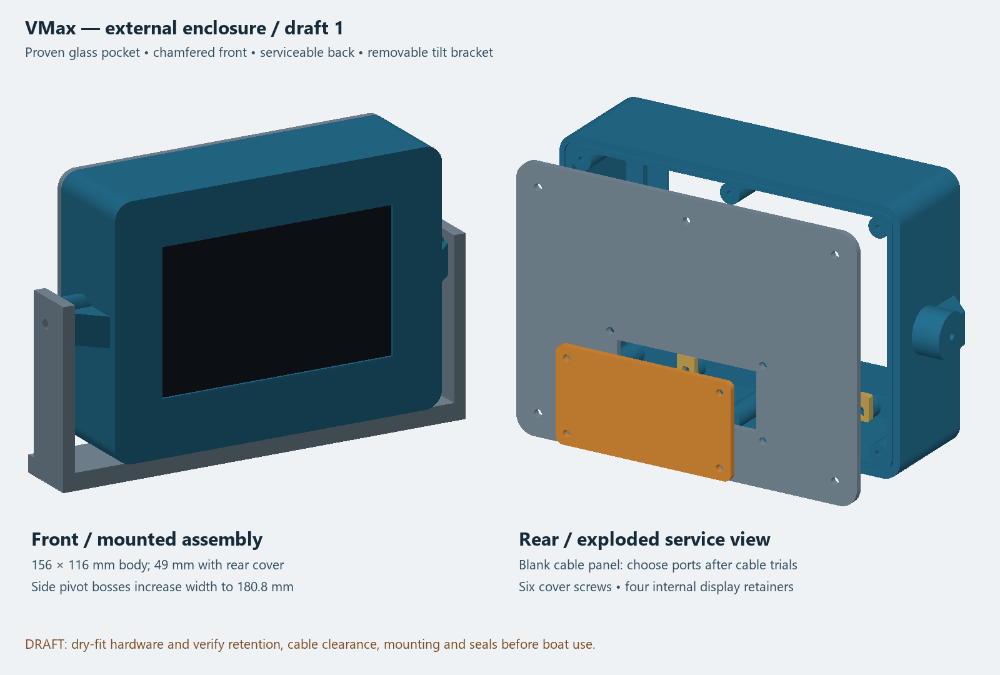

# External enclosure — draft 1

First external prototype for the Waveshare ESP32-S3-Touch-LCD-5 capacitive
800x480 assembly. All files are millimeters; import at 100% scale.
This is a printable mechanical draft awaiting physical assembly validation.

## Print files

**Three-port requirement:** the acquired QIANRENON microSD/TF bulkhead
extension adds a third rear-panel connection beside NMEA and USB-C. Its listing
specifies a 21 mm round mounting hole, panel thickness no greater than 6.3 mm,
13/16-28 UNS thread, 16 cm / 6.3 in FPC ribbon, a nominal 28 mm / 1.1 in
dimension, included nut/O-ring/tethered cap, and claimed IP67 protection.

The current 80 × 42 × 3 mm replaceable panel is within the listed microSD panel
thickness limit. However, the existing 64 × 26 mm rear-cover opening and the
unknown outside envelopes of all three connector flanges, nuts and caps have
not been shown to fit together. Do not drill or release a final three-port STL
until the received NMEA, USB-C and microSD parts have been measured together.
The new panel must preserve its four fasteners and gasket land while providing
card/cap access, nut tool clearance, internal cable projection, ribbon bend
radius and strain relief.

`cable-panel-two-port.stl` is retained only for NMEA and USB-C fit testing.
It preserves the 80 × 42 × 3 mm outline and four screw holes, with 16 mm holes
at X=-17 and +17 mm. It is superseded as the final configuration. The blank
panel remains the safe starting point for the three-port redesign. See the
[microSD component record](../../../hardware/datasheets/QIANRENON-MicroSD-Panel-Extension.md)
and the project [enclosure requirements](../../../docs/Enclosure.md).

| File | Quantity | Supplied orientation |
| --- | --- | --- |
| housing.stl | 1 | Flat front face on bed, open rear upward |
| rear-cover.stl | 1 | Flat exterior face on bed |
| cable-panel-blank.stl | 1 | Flat on bed |
| display-retainer-print-4.stl | **4** | Flat on bed; file contains one retainer |
| tilt-bracket.stl | 1 | Mounting base on bed, two arms upward |

The chamfered front bezel is **integral to this housing**. The earlier bezel
prints are fit-test pieces and do not attach to this housing.

Start with housing and four retainers; check the real board and your cables
before printing the cover and bracket. Suggested PETG starting settings:
0.20 mm layers, 4 perimeters, 5 top/bottom layers, 20-25% infill. Pivot bosses
have 45-degree support ribs. The draft is designed for printing without
supports; inspect your slicer's preview around the side bosses and small
horizontal pivot holes. Clean or drill holes to size after printing. The
bracket arms are 82 mm tall: use a brim if needed for stability.

## Size and preserved fit

- Body: 156 x 116 x 46 mm; 49 mm including rear cover.
- Cable panel adds another 3 mm locally, plus any gasket and connectors.
- Housing including side pivots: 180.8 mm wide.
- Bracket: 192 mm wide, 30 mm base depth, 82 mm high.
- Glass pocket: **128.30 x 88.05 mm, R4.30**, the user-confirmed fit dimensions.
- Window: **110.00 x 66.80 mm**, centered 1.475 mm toward the top.
- Front window chamfer: 0.8 mm at 45 degrees; front lip 2 mm thick.
- Behind the first 5 mm, nominal interior is 144 x 104 mm before posts.
- Rear cover screw centers: (+/-68,+/-48) and (0,+/-48), referenced to screen center.

The official touch drawing shows 127.70 x 87.45 glass, 109.00 x 65.80 viewing
area, R4 corners, and a 14 mm assembly depth. Source:
https://docs.waveshare.com/assets/images/ESP32-S3-Touch-LCD-5-touch-size-2-f55a9abf7b42455adbc880b71b4b92f9.webp

The 46 mm housing depth is a design allowance for wiring, not a verified cable
bend envelope. No connector bodies or full board assembly are modeled.

## Hardware for initial dry assembly

Use stainless hardware for the eventual boat installation. Lengths below are
starting choices; verify engagement with the actual washers and printed holes.

- Rear cover: six M3 x 10 mm coarse plastic-thread screws with washers.
  Housing has 2.6 mm pilot holes, 12 mm deep; cover holes are 3.4 mm.
  These pilots are intended for plastic screws, not untapped machine screws.
- Display retainers: four M3 x 6 mm coarse plastic-thread screws, washers,
  and small soft silicone/foam pads. Pilots are 2.6 mm, about 4.6 mm usable.
- Cable panel: four M3 x 10-12 mm machine screws, washers and locknuts.
  Both panel and cover holes are 3.4 mm. Fit nuts inside before closing cover.
- Pivots: two M4 x 12 mm machine screws with broad washers. **Tap the blind
  3.3 mm pilot holes M4 first.** A 5.5 mm bracket arm and 0.1 mm nominal side
  gap leave roughly 5 mm thread engagement after a 1 mm washer. Measure first;
  do not bottom screws or heavily tighten printed threads. Printed pivot
  threads are provisional; metal inserts can be specified in a later revision.
- Bracket base: two M5 bolts/locknuts or an appropriate clamp, selected for
  the mounting surface. Holes are 5.4 mm on 120 mm centers. Secure the base;
  its narrow footprint is not designed as a freestanding desktop stand.

## Fit and assembly

1. Clear first-layer bulges from the glass pocket. Place the front face on a
   clean soft surface and gently seat the display from the open rear. The
   wider glass border belongs at the bottom. Never force the glass.
2. Four retainer posts at X=+/-40, Y=+/-48 end at Z=10 mm, measured from the
   outside front face. Fit the four fingers with their long ends pointing
   inward. Slots provide slight position adjustment. The fingers should
   overlap only the rear of the glass border, away from the PCB and flex cables.
3. **Measure the actual glass-back height** and fit soft pads to fill the gap
   under each finger. Pad thickness is deliberately unspecified until measured.
   Pads should cushion/lightly retain the display without bending the glass
   or board. If any finger contacts a component, cable, or the LCD module,
   stop and revise its geometry. Do not tighten screws to compensate for a gap.
4. Confirm the display remains supported with the rear cover removed. This
   draft does not use the PCB mounting holes; the retained display assembly
   carries its own attached PCB. Shake/vibration retention requires validation.
5. Route your USB and NMEA leads through the open rear and check plug insertion,
   microSD access, wire bend radii and strain-relief locations. USB battery power
   and separate NMEA drop wiring remain the existing electrical arrangement.
6. Fit the cover and blank panel. The final replaceable panel now needs three
   bulkhead connections: NMEA, USB-C and microSD. The current panel covers a
   64 × 26 mm rear opening; confirm that this opening can be enlarged while
   retaining the panel fasteners and gasket land. Measure all three received
   connector envelopes before drilling. Provide internal strain relief and a
   gentle supported bend for the microSD FPC ribbon.
7. Fit the U bracket. Start at the nominal upright angle. Check corner/base
   clearance, cable clearance and screw engagement throughout any tilt you use.
   A tilt range or load capacity has not been established.

## Sealing provisions and open work

The rear housing rim has a continuous 1.6 mm wide, 1.2 mm deep rounded groove,
nominally for 1.5 mm silicone cord (20% compression against the cover). The
centerline is 150 x 110 mm, R5.5. Cord length is approximately 511 mm before
join allowance; fit and seal the joint per the chosen gasket material.
Six screw holes lie inside the gasket track. Seal cover fasteners with bonded
sealing washers or another tested method; the track alone does not seal holes.

The blank panel needs a cut silicone sheet gasket between it and the cover,
with sealed fasteners. A nominal 1 mm gasket is a starting point, not a tested
compression specification. No panel gasket is supplied as an STL.

The front preserves the proven bare-glass seat without a gasket recess. A thin
compatible silicone seal around the perimeter is a planned provision; its
thickness and glass compatibility must be checked before bonding. A thicker
front gasket would change seating depth and retainer-pad requirements.

The draft **is not water-tested or ready for exposed boat use**. Final connector
holes, cable strain relief, a hydrophobic vent, buzzer mounting, front seal,
panel gasket, fastener seals and mounting security remain to be resolved. Do
the enclosure document's unpowered spray tests before exposing electronics.
Use this first print for dry fit, cable selection and mounting evaluation.
PETG is suitable for the dimensional prototype; ASA remains the project choice
for the later outdoor enclosure.

## Editable models and checks

Individual OpenSCAD files and `assembly.scad` are in `../../CAD/external-v1/`.
The assembly file is for review, not printing. Their geometry is generated from
the parameterized `../../CAD/external-enclosure-v1.py`; edit that file to keep
all parts, exports and previews consistent. It needs manifold3d 3.5.4, numpy
and Pillow. The original fit-test models are preserved.

`validation.json` records STL bounds and closed, consistently wound meshes.
Each part is one connected solid; nominal housing, cover, panel, bracket and
retainers pass pairwise interference checks. Hardware, real display, seals,
loads and cable clearance are excluded from those checks and need physical
validation. The preview uses the exported geometry with a glass placeholder.
